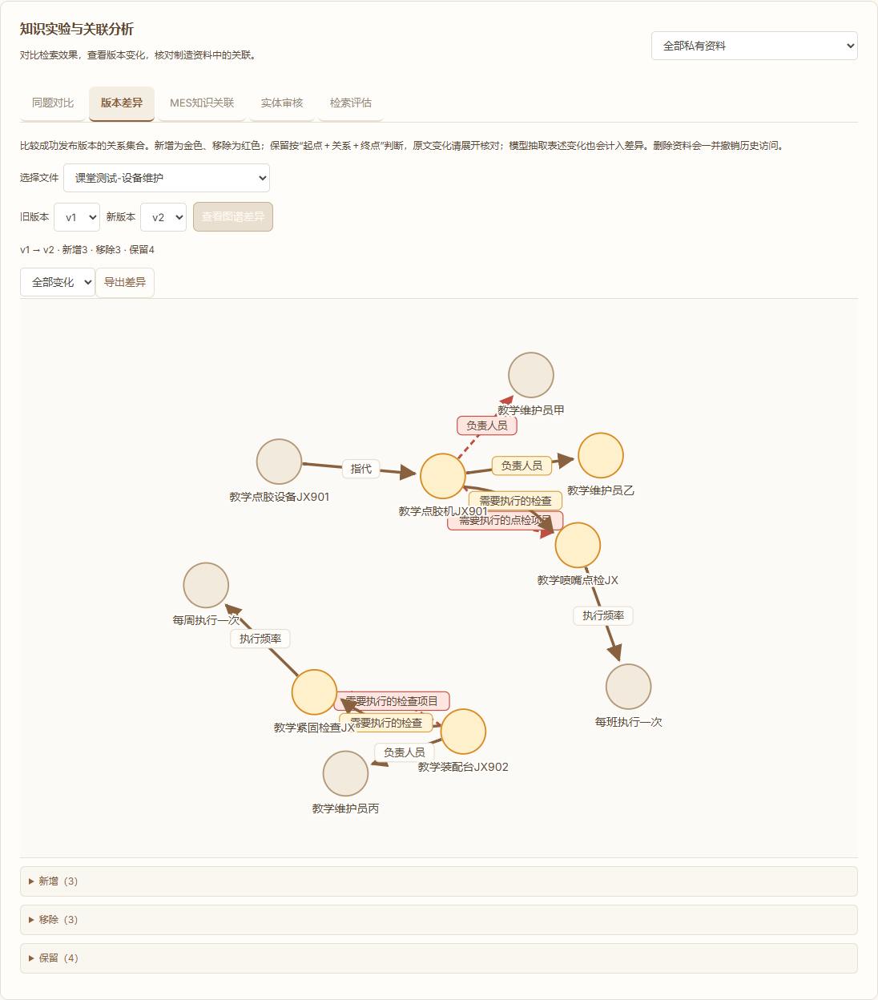
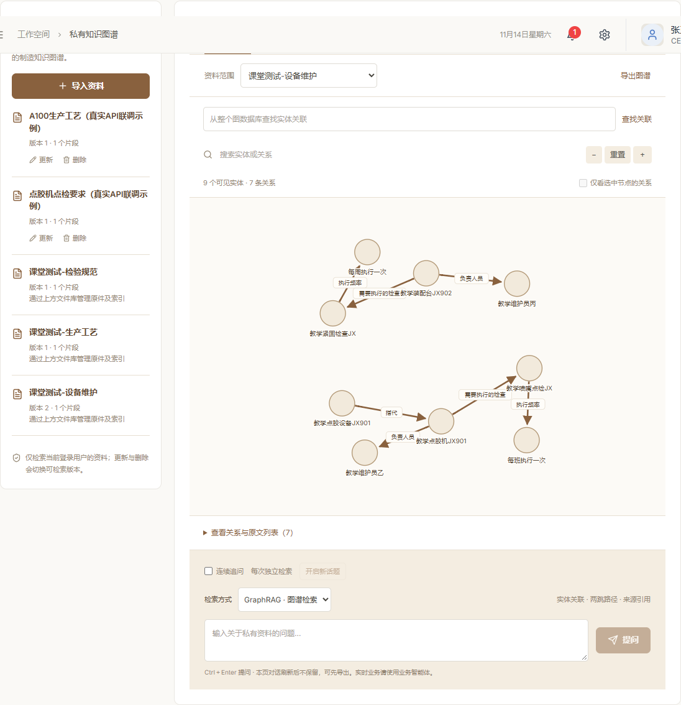

# 任务三三个区域：从导入到验收的手工测试流程

适用版本：2026-11-14的知识工作台。全部数据均为虚构课程资料，可以用于截图、录屏和答辩。建议先用同一个演示账号，按本文顺序测试，约需25—40分钟。模型回答和关系数量可能随抽取变化，以原文、版本和关键事实为准。

## 先弄清三个区域各做什么

| 页面区域 | 主要用途 | 常用按钮 |
| --- | --- | --- |
| 文件资料库 | 管理上传的原始文件、处理进度、版本及删除 | 上传文件、查看正文、下载原件、替换原件、重试同步、删除文件 |
| 知识实验与关联分析 | 比较检索模式、查看新旧图谱变化、查询MES关联、审核实体、运行评估 | 同题对比、版本差异、MES知识关联、实体审核、检索评估五个标签 |
| 知识图谱／问答 | 查看节点和关系来源，提问，查看答案证据子图，连续追问 | 知识图谱、有据问答、检索方式、提问、查看本次回答子图、连续追问 |

页面顶部有三个同名区域快捷入口，点击即可跳到对应区域。左侧“私有资料”是图谱资料列表；本流程的原件管理统一在最上方“文件资料库”操作。

## 测试文件清单：不要一次把全部文件上传

| 文件 | 什么时候使用 | 作用 |
| --- | --- | --- |
| `01_教学生产工艺.txt` | 第一步上传 | 产品→工序→设备／检验关系 |
| `02_教学设备维护_第一版.txt` | 第一步上传 | JX901负责人是教学维护员甲，另有点检及别名称呼 |
| `03_教学检验规范.txt` | 第一步上传 | 检验仪器、质检人员、喷嘴清洁要求 |
| `04_教学设备维护_第二版.txt` | 更新测试时替换02的原件 | 只把JX901负责人甲改为乙，其他正文不变 |
| `05_异常测试_超过12000字符.txt` | 最后可选异常测试 | 故意超长，用于确认替换失败后仍保留旧版本 |
| `06_可直接复制的问题.txt` | 提问时打开复制 | 本文所需问题集合，不用上传 |
| `附录_18题评估资料` | 仅供了解内置评估用的原文与标准 | 与主流程的JX／C900数据不同；建议直接用页面按钮导入内置评估，不要混用 |

**最重要：04是02的替换原件，不能先作为一份独立的新文件上传。否则会同时出现甲、乙两种负责人记录，无法正确演示版本更新。**

## 一、启动与登录

1. 先解压整个测试包到一个固定文件夹，保留文件名。
2. 项目根目录双击 `启动知识图谱.cmd`。本机API配置已经保存；正常情况下不需再次输入密钥。
3. 浏览器打开 `http://127.0.0.1:5173/knowledge`。若进入登录页，先登录再打开此地址。
4. 推荐本次完整手工测试使用设备管理员演示账号 **108001**，默认演示密码 **123456**。管理员109001也可以使用相同功能；若本机已改密码，请使用实际密码。整个流程保持同一个账号，不要中途换账号。
5. 在页面顶部点击“检测连接”，应显示Neo4j已连接。可点击一次“测试模型”检查聊天服务。

**通过标准：** 能看到三个区域；没有“知识库尚未启用”或持续网络错误。界面为系统一致的米白纸面、暖棕色操作、细边框。

**2026-11-14本轮自动核验后：** 109001的今日嵌入调用已用18/20次，108001尚未使用；为避免第三份资料上传到一半遇到限额，本次推荐使用108001。账号之间资料隔离，换账号后看不到另一账号的私有文件是正常现象。这个数字是当日检查结果，之后会随调用或日期改变。

模型有调用次数限制。三模式对比会运行三种模式，嵌入调用也会计数；本流程一次完整演示通常无需反复重新上传。遇到限额应查看提示或稍后再测，不要连续重试消耗请求。

## 二、区域一：文件资料库

### T01：依次导入三份第一版资料

在“文件资料库”点击“上传文件”，每份单独上传一次：

| 上传文件 | 建议填写的文件标题 |
| --- | --- |
| 01_教学生产工艺.txt | 课堂测试-生产工艺 |
| 02_教学设备维护_第一版.txt | 课堂测试-设备维护 |
| 03_教学检验规范.txt | 课堂测试-检验规范 |

选择文件后核对标题，点击“保存并同步索引”。等待本份完成后再上传下一份。

**应该看到：** 解析正文→生成向量→抽取关系与构建图谱→发布索引→完成；文件状态和图谱状态均为已发布，新上传文件的最新操作及可检索版本均为v1。

**通过标准：** 三个文件都发布成功，下方“私有资料”出现相同标题。关系条数不要求固定。

### T02：正文和下载原件

1. 在“课堂测试-设备维护”点击“查看正文”。
2. 确认其中包含“教学点胶机JX901由教学维护员甲负责。”
3. 点击“下载原件”，用记事本打开，确认与02文件一致。

**通过标准：** 预览正文与下载原件均为第一版，不出现教学维护员乙。

### T03：刷新后仍能找到资料

刷新浏览器，三个文件和图谱应仍存在。若刚好在处理期间刷新，重新打开同一账号页面后，仍可看到服务器保存的处理阶段和后续状态。不要为了截取某个阶段连续重复上传。

## 三、区域三：先查看知识图谱，再提问

### T04：查看图节点、关系与原文

1. 点击顶部“知识图谱与问答”快捷入口。
2. 在“知识图谱”页签中，可先将资料范围选为“课堂测试-生产工艺”，避免旧演示资料干扰画面。
3. 找到教学演示鼠标C900、教学点胶工序JX、教学点胶机JX901等节点。
4. 点击一个节点，查看直接关系；可勾选“仅看选中节点的关系”。
5. 点击连线或关系文字，查看来源文件标题、版本和引用原文。TXT资料定位显示“正文”，不是PDF页码，这是正常的。
6. 测试搜索、放大、缩小、重置；再把资料范围切回“全部私有资料”。

**通过标准：** 节点和关系来自这三份正文，点击可核对原文，资料范围能改变可见图谱。

### T05：跨文件GraphRAG问答

检索方式选“GraphRAG · 图谱检索”，资料范围选“全部私有资料”，输入：

```text
教学点胶工序JX使用的设备由谁负责？
```

点击“提问”，应识别教学点胶机JX901，负责人为教学维护员甲。展开[S1]等来源卡片，检查设备关系来自工艺文件、负责人来自设备维护文件；来源编号顺序可以变化。

点击“查看本次回答子图”，应看到金色证据节点与关系。试用“只看本次回答子图”“返回回答”“退出回答高亮”。

**通过标准：** 答案关键事实正确且有来源；子图能核对“工序→设备→负责人”。如果召回额外检验关系，不表示答案错误，仍要核对回答实际引用。

### T06：连续追问

1. 勾选问答框上方“连续追问”；如已有会话，点击“开启新话题”。
2. 第一问输入：

```text
教学点胶机JX901由谁负责？
```

3. 待回答结束后，再输入：

```text
它需要做什么点检？
```

**应该看到：** 第二问显示改写后的独立检索问题，指向JX901，并回答教学喷嘴点检JX，附新的来源。

**通过标准：** “它”能够明确对应上轮设备；回答重新检索资料，而非只重复上一轮答案。更换资料范围、更新文件或会话过期后，系统会要求开启新话题。

### T07：没有依据时拒答

开启新话题或取消连续追问，再输入：

```text
教学演示鼠标C900在2028年的销售额是多少？
```

**通过标准：** 返回“当前资料不足，无法回答该问题。”，不能编造销售额。

## 四、区域二：知识实验与关联分析

### T08：同题三模式对比

1. 点击顶部“知识实验与关联分析”。
2. 页签选择“同题对比”，实验资料范围选“全部私有资料”。
3. 输入T05的同一个跨文件问题，点击“运行三模式对比”。
4. 等待RAG、GraphRAG、HYBRID三个结果显示，比较答案、耗时、来源及召回关系。
5. 点击“导出对比结果”，保存JSON证据。

**通过标准：** 三个结果各自显示真实结果与耗时，失败时单独保留错误，不覆盖其他模式。RAG可能召回不足并拒答，不能把“必须三种模式都完整答对”当作通过条件；重点比较图谱能否连接跨文件依据。

### T09：MES知识关联

1. 切换“MES知识关联”，实验资料范围保持“全部私有资料”。
2. 点击“加载当前实体”。
3. 起始实体选择“教学点胶机JX901”，点击“查询制造关联”。
4. 查看关联的工序、负责人、点检及原文来源。图谱使用最多两跳，不能保证列出无限深的所有关系。

**通过标准：** 有与JX901相关的关系、来源文件和原文，且不会把资料描述宣称为当前实时生产状态。未人工确认的类型分组可能来自名称规则建议。

### T10：实体类型与别名审核

1. 切换“实体审核”，点击“检查图谱质量”。
2. 审核实体选择“教学点胶机JX901”，确认实体类型选“设备”，点击“确认类型”。
3. 对“教学点胶设备JX901”重复确认设备类型。
4. 选“教学点胶设备JX901”为审核实体，规范名称选“教学点胶机JX901”，点击“确认这两个称呼指同一实体”。
5. 确认页面出现“教学点胶设备JX901 → 教学点胶机JX901”。
6. 返回问答，使用GraphRAG询问“教学点胶设备JX901由谁负责？”，核对负责人甲及来源。
7. 可回实体审核点“撤销别名”，再检查映射已消失。

**通过标准：** 类型和确认映射能保存、可撤销，原始关系与原文保留。不同型号数字不能确认为同一实体；别名不是把两个原始节点直接删除合并。若某个称呼未被模型提取为节点，就不能凭空审核，应先查看该文件建图结果。

## 五、更新文件，观察图谱和答案一起改变

### T11：替换设备维护原件

1. 回“文件资料库”。
2. **找到“课堂测试-设备维护”的原卡片，点击“替换原件”。**
3. 选择 `04_教学设备维护_第二版.txt`，保留原文件标题，点击“保存并同步索引”。
4. 等待文件和图谱共同发布，新建后第一次替换应为v2，仍然是同一个逻辑文件。
5. 点击“查看正文”或“下载原件”，确认负责人已变为教学维护员乙。

**通过标准：** 同一文件的版本递增；负责人甲被乙替换。文件库没有额外新建一份“第二版”资料。

### T12：图谱版本差异

1. 在“知识实验与关联分析”切换“版本差异”。
2. 文件选“课堂测试-设备维护”，旧版本选v1，新版本选v2；如果已经测试过多次，以本次更新对应的实际版本为准。
3. 点击“查看图谱差异”。
4. 新增关系应包含“教学维护员乙”，移除关系应包含“教学维护员甲”。切换新增／移除／保留筛选，点击关系核对引用。
5. 点击“导出差异”。

**通过标准：** 能解释旧负责人消失、新负责人出现。关系集合按文字三元组比较，模型对点检等内容的抽取措辞变化也可能产生其他新增／移除，不要求只有一条变化。

### T13：新答案和旧会话保护

1. 若仍保留更新前的追问话题，直接追问，应提示资料范围或版本变化。
2. 点击“开启新话题”，或取消连续追问。
3. 图谱资料范围选“课堂测试-设备维护”，使用GraphRAG输入：

```text
当前版本教学点胶机JX901由谁负责？
```

**通过标准：** 回答教学维护员乙，引用设备维护的新有效版本。旧答案可作为历史记录保留，但不能再被当作当前版本答案；点击旧回答子图时也会重新核对服务端版本。

## 六、可选：运行内置18题评估

此步骤使用另一套专用数据A100／DG01，不使用上面JX／C900的三份文件。

1. “知识实验与关联分析”→“检索评估”。
2. 点击“导入三份评估样例（真实建图）”。不需要手工上传附录文件，按钮会直接生成相同原文。
3. 确认专用样例就绪3/3、评估阶段1。
4. 先使用默认的Q01、Q08和GraphRAG，点击“运行所选评估”。
5. 核对每题答案及来源，观察关键词覆盖、预期来源召回、引用检查；人工核对后才勾选“语义正确”。
6. 点击“导出评估报告”。自动指标不等于语义准确率，未勾选人工复核时不应声称完成了人工评测。
7. 需要完整评估时再选择Q01—Q16；选择三种模式会增加调用量，建议先完成单模式。
8. 点击“发布负责人变更为第二版”，设备负责人由张师傅变为赵师傅；页面自动切到更新题Q17、Q18。
9. 运行更新题，确认新答案和来源版本，再导出报告。

如果已有一套第二阶段评估样例，不能再用第一阶段答案标准评判它；需要先在文件库删除这三份“评估样例：…”资料，再点击导入按钮重新开始。文件实际版本号可能继续递增，评估阶段以原文中的张师傅／赵师傅判断。

## 七、可选：失败回退测试

在完成所有正常功能截图后再做：

1. 在“课堂测试-设备维护”点击“替换原件”。
2. 选择 `05_异常测试_超过12000字符.txt`，保存。
3. 应明确显示正文超限／新版本未发布，文件状态失败，旧可检索版本保留。
4. 首次演示时可能显示“最新操作v3、可检索v2”；数字不同不影响验证，关键是失败操作没有替换有效版本。
5. 下载原件，应仍是包含负责人乙的第二版；图谱和问答也应仍使用乙。
6. 在版本差异的成功历史中，失败版本不应成为可比较的成功快照。
7. 若要恢复成功状态，点“替换原件”，重新选择04正确文件发布一个更高版本。对超长原件直接“重试同步”仍会失败，因为原件本身没有修正。

## 八、清理与重复测试

1. 先在实体审核中撤销本次确认的别名；仅撤销你此次创建的映射。
2. 在文件库删除三个“课堂测试-…”文件。内置评估样例可另外删除，也可保留用于演示。
3. 删除后该文件应退出私有资料和图谱；历史差异访问也随文件撤销。
4. 如果显示“清理待重试”，展开“文件处理记录”，点击“重试删除清理”，直到完成。
5. 下次完整测试时仍先导入01、02、03，随后用04替换02，不要把四份同时当作独立资料导入。

## 九、记录结果与常见问题

| 检查点 | 通过时的关键现象 | 结果 |
| --- | --- | --- |
| 三份第一版原件上传 | 文件与图谱均已发布 | □通过 □失败 |
| 下载原件 | 正文与本地文件一致 | □通过 □失败 |
| 图谱节点与关系 | 可查看来源标题、版本、原文 | □通过 □失败 |
| 跨文件问答 | 设备JX901＋负责人甲＋来源 | □通过 □失败 |
| 回答子图 | 证据节点和关系高亮 | □通过 □失败 |
| 连续追问 | “它”解析为JX901，返回喷嘴点检 | □通过 □失败 |
| 资料不足 | 不编造销售额 | □通过 □失败 |
| 同题对比 | 三列真实结果，支持导出 | □通过 □失败 |
| MES关联 | 有相关关系、分类与来源 | □通过 □失败 |
| 实体审核 | 同型号映射可确认、可撤销 | □通过 □失败 |
| 原件更新 | 甲→乙，同一文件新版本 | □通过 □失败 |
| 版本差异 | 新增乙、移除甲 | □通过 □失败 |
| 更新后问答 | 乙＋新版本来源 | □通过 □失败 |
| 失败回退（可选） | 超长失败但旧有效版本不变 | □通过 □失败 |
| 18题评估（可选） | 区分第一阶段和更新题，可导出实际结果 | □通过 □失败 |
| 删除清理 | 原件退出、图谱撤销、必要时可重试清理 | □通过 □失败 |

常见情况：

- **没有看到新样式：** 先刷新页面；仍是旧样式时用Ctrl＋F5强制刷新。确认使用端口5173与最新整合分支。
- **没有看到知识实验区域：** 确认已登录并启用知识模块；页面顶端有三个区域快捷入口。
- **版本差异没有历史：** 需要同一逻辑文件两次成功发布，且都发生在快照功能启用后；“上传成两份文件”不能比较同一文件版本。
- **图谱里还有其他设备：** 选择本次文件缩小范围，或者搜索教学前缀。做跨文件问答时再切回全部资料。
- **同题RAG拒答：** 可能是向量召回阈值导致资料不足，保留真实结果；GraphRAG能通过关系补充跨文件证据。
- **模型或嵌入返回403／404：** 检查模型权限、模型ID和本地配置；不要将API Key放入截图或报告。
- **每天调用达到上限：** 暂停重复测试。内置评估默认只运行两题，完整18题或三模式需要更多调用。

截图建议：文件发布完成、节点关系原文、跨文件问答及来源、回答证据子图、三模式对比、版本差异、负责人乙的新答案、评估导出各留一张。截图必须标明实际测试日期，不把旧截图当作当天现场运行。


## 十、本测试包的实际核验

2026-11-14已使用本包的01—05原件及上述问题完成18项真实检查，包括三份原件发布、三模式对照、连续追问、MES关联、资料不足、原件替换、图谱差异、旧会话失效、最新版本问答、共享主题、手机布局、超长失败回退、旧原件下载及失败版本不进入成功历史。虚构测试文件已经自动删除，供你重新按流程导入。

下面截图来自该次真实运行的新样式，所有设备和人员均是本包虚构数据。截图中的示例版本不应替代你自己的实际测试记录。





