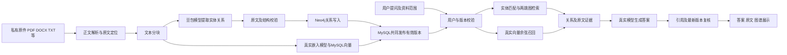

# MouseMES 任务三设计与实现说明

任务三在原鼠标生产MES中增加基于Neo4j知识图谱和大模型的私有资料问答。重点是将工艺、设备及检验资料中的实体关系连接起来，支持跨文件检索，并展示回答所用的原文依据。任务一负责人脸登录，任务二负责统一文件库与向量检索，本说明已更新为任务二三整合版本，描述任务三实现及共享文件库的对接边界。

## 一 需求对应

| 课程要求 | 实现 |
| --- | --- |
| 私有文件到图数据库及更新 | PDF／DOCX／TXT／MD／CSV原件管理、分块、模型关系抽取、Neo4j写入、双索引发布、更新删除及重试 |
| RAG和GraphRAG选择或融合 | 三种模式共用问答页；RAG通过VectorRagRetriever接入真实嵌入向量召回，融合模式合并图谱与向量证据 |
| 前端知识图谱可视化 | 节点、曲线关系、实体关联查询、资料范围、缩放、节点聚焦、回答子图高亮、文件页码／段落溯源及导出 |
| GraphRAG智能问答 | 实体定位、两跳图遍历、原文召回、大模型回答、来源编号校验及资料不足处理 |

这里实现的是实体关系图谱增强检索，不包含社区发现、社区摘要、图神经网络或完整微软GraphRAG流水线。“图谱写入”与“图向量嵌入”是不同的能力，当前系统未实现图向量表示。

## 二 系统结构

后端采用原项目Spring Boot与JdbcTemplate，图数据库使用Neo4j Query API。模型通过服务端HTTP客户端调用火山方舟doubao-seed-2-1-lite-260915；前端为Vue3，图谱使用SVG绘制，不依赖浏览器直接连接图数据库或持有模型密钥。

## 三 文件分块与图建模

文件请求包含documentId、title、version、text。documentId标识逻辑文件；version在修改和删除时递增。所有者从原系统登录会话取得，不能由浏览器请求体指定。

单份文本最多12000个Java字符串长度单位。文本按1800字符分块，重叠150字符，并避免拆开UTF-16代理对。分块编号为buildId与ordinal的组合。模型每片最多提取30条关系，实体名称和连续引用必须在原文中存在。重叠片段产生的相同实体、关系和引用在发布前去重。

Neo4j使用MMKGEntity节点和MMKG_REL关系。节点按“用户ID＋实体名”唯一，不同用户的同名设备不会合并；同一用户的同名实体可连接不同文件。关系保存owner、documentId、version、buildId、chunkId、relation和quote。关系名称作为属性存储，不把模型文本拼成Cypher结构。

MySQL的mm_kg_document保存当前状态、正文、分块和有效buildId。所有图查询都带用户ID和有效构建集合，使未发布、旧版本或崩溃遗留的关系不能进入问答。

## 四 检索与回答

GraphRAG首先从问题匹配现有实体，沿合法关系扩展一至两跳。没有直接匹配时，新版本代码可将最多300个当前用户、当前资料范围内的候选名称交给模型定位简称；最多选择4个实体，并逐项校验其属于候选集。该能力需要部署task3-r3版本，并非向量实体检索。

RAG模式通过VectorRagRetriever调用任务二AuthorizedChunkIndex，使用1024维真实嵌入向量和余弦精确召回；仅召回已经授权的当前版本片段，精确匹配时复用上传阶段向量。融合模式将两类片段按chunkId去重。外部召回如果返回无权、过期、改写或超量片段，服务端直接拒绝。

回答依据最多12个来源片段及40条关系，要求业务事实标注[S1]等真实来源编号。无依据时允许返回固定的资料不足句，不为不存在的事实制造引用。格式不符合时最多再请求模型修正一次，第二次仍不符合就报错。模型处理完成后再次检查来源是否仍是当前有效版本，防止回答生成期间被修改或删除的资料继续作为结果返回。

问答默认每次独立检索；开启连续追问后，服务端保存短期上下文，将指代改写为独立问题后重新检索。上下文按owner及资料构建版本验证，有效期2小时，资料变化后必须开启新话题。页面对话列表刷新后不自动恢复，可提前导出。

## 五 更新删除与一致性

文件更新在MySQL事务中锁定逻辑文件。相同版本相同内容重试直接返回，不重复调用模型建图；旧版本或同版本不同内容被拒绝。先完成Neo4j写入，再由MySQL发布新buildId。抽取或写图失败时回滚，旧版本继续有效。

删除先提交DELETED_PENDING，使文件立即退出检索，随后删除不高于删除版本的图关系。清理成功后标记DELETED；失败记录保存在MySQL，刷新后仍能重试。更高版本重新发布后，旧删除清理不会误删新版本。此机制不是跨MySQL与Neo4j的分布式事务，旧构建物理回收仍有改进空间。

## 六 核心代码位置

| 文件或类 | 职责 |
| --- | --- |
| knowledge/KnowledgeController.java | 登录身份、接口参数与返回格式 |
| knowledge/KnowledgeService.java | 文件版本、检索编排、引用与最新版本复核 |
| knowledge/KnowledgeModel.java | 方舟协议、关系抽取、候选实体定位及回答 |
| knowledge/Neo4jKnowledgeStore.java | 参数化图写入、实体查询及两跳遍历 |
| knowledge/KnowledgeRepository.java | 私有文档及删除重试状态持久化 |
| knowledge/RagRetriever.java | 任务二向量检索扩展边界 |
| views/knowledge/KnowledgeWorkspace.vue | 资料管理、图谱与问答界面 |

Java路径均相对于01-backend/src/main/java/com/mouse/mes，Vue路径相对于02-frontend-web/src。

## 七 已有验证与待合并事项

真实方舟联调已完成两份示例资料抽取，共27条关系，以及一次带双文件来源的跨文件回答。task3-r3已实际部署，新一轮14项真实生命周期检查全部通过，涵盖真实模型更新、三种模式读取新版本、删除后拒绝旧文件范围及旧版本重放，以及修正后的资料不足回应。另有简称定位和无关问题两项真实样例通过，详见第三轮完善与验收记录。

统一多格式文件库、原件下载、向量嵌入与索引同步由任务二负责；任务三已经提供稳定的接口和对接清单。个人报告应如实填写各自提交、实际操作和解决的问题，不能将他人的工作或未完成联调写成个人已验收成果。

## 八 本轮展示与恢复完善

图谱组件KnowledgeGraphCanvas使用确定性斥力布局、平行关系曲线和可交互标签；点击关系显示来源文件、版本、页码／段落和引用原文。回答可切换到证据子图，金色高亮回答使用的关系，并可切换全图。资料版本改变后禁止打开过期回答的子图。

文件库以rag_progress持久化解析、嵌入、图谱构建、发布和完成阶段，客户端每2秒读取状态，刷新后恢复。阶段事务独立提交；进度记录写入失败不改变索引发布结论。超过30分钟没有阶段更新的处理转为FAILED并允许同版本重试，保留旧activeVersion。

最终报告、真实对照和截图见《任务三课程报告_整合版.md》及《任务三五项完善与扩展验收.md》。早期阶段记录保留历史上下文，不作为当前功能缺项说明。

## 九 六项实验与关联功能（2026-11-09）

KnowledgeLabRepository新增成功版本快照、实体审核、别名字典和短期追问表；KnowledgeLabService实现三模式比较、图谱差异、制造关联和追问编排。快照随发布事务提交、随文件删除撤销。对比与追问在返回前复核资料构建版本。实体类型与别名由人工确认，受型号数字、类型冲突及循环限制。

前端KnowledgeLab展示五个实验面板，原问答框支持连续追问。18题标准包含单文件、跨文件、同义表达、资料不足和更新后问题，自动记录关键词覆盖、来源召回、引用检查、错误与耗时，并提供独立人工复核标记。完整结果和限制见《任务三六项加分功能与验收.md》。
