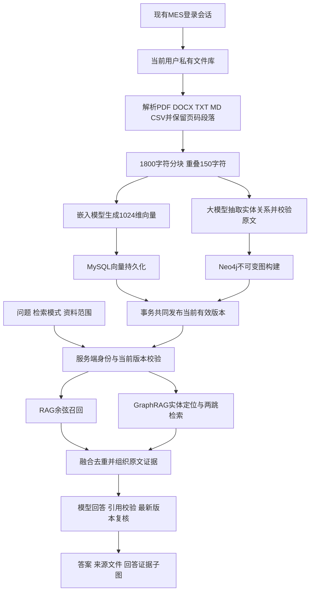
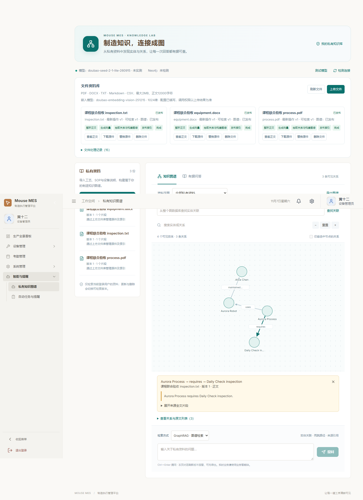
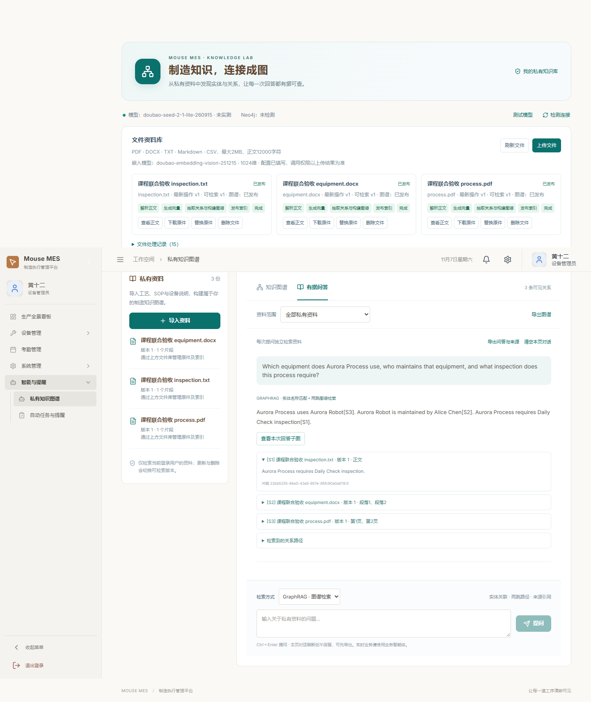
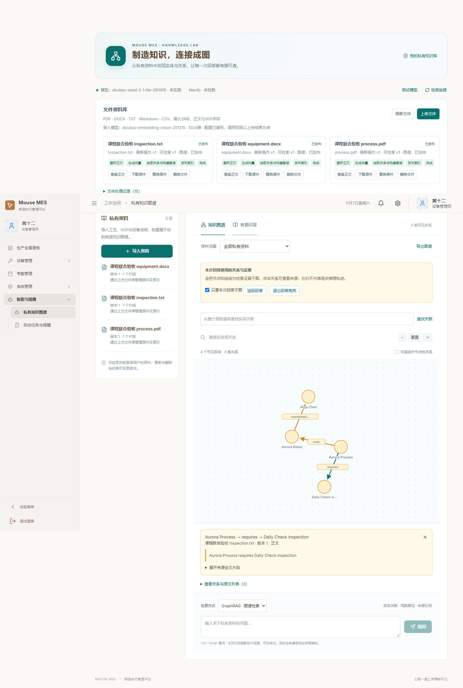
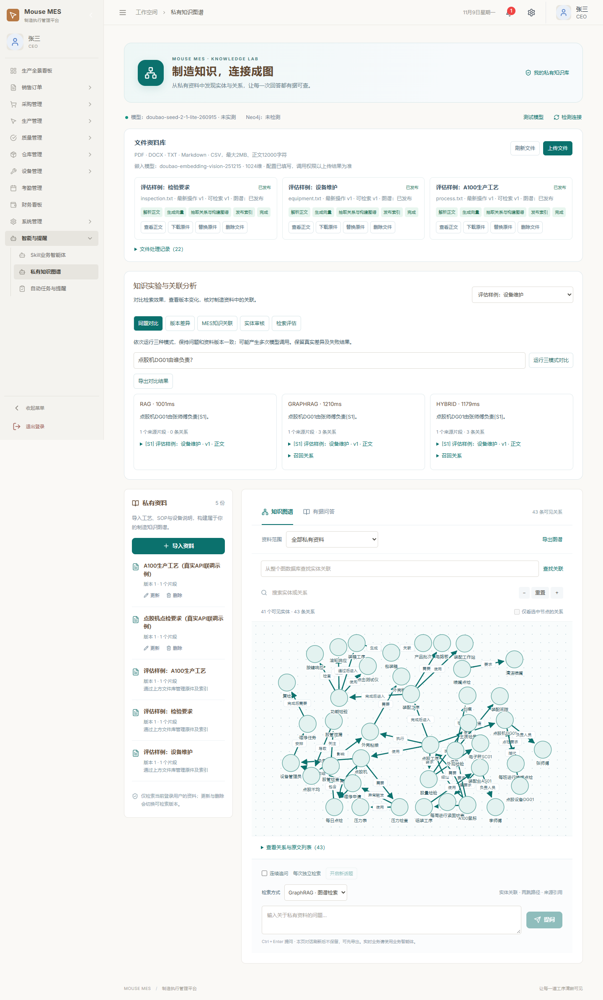
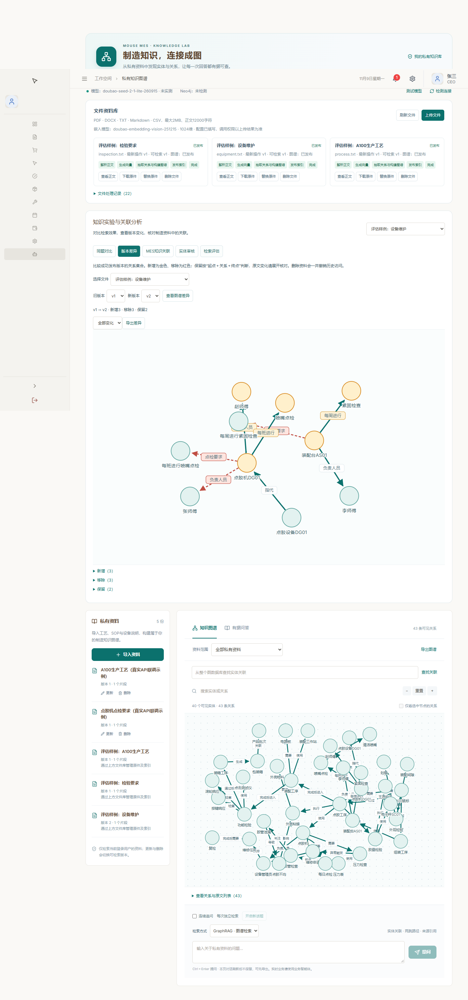

# 鼠标生产MES私有知识图谱与智能问答模块

任务三课程报告，更新日期：2026年11月9日。

## 1. 项目背景与目标

本项目在已有鼠标生产制造执行系统（MouseMES）上完善课程功能。工艺、设备和检验资料通常分散在不同文件中，单份文档查询难以直接回答“某工序使用什么设备、设备由谁维护、还需要什么检验”等关联问题。本模块将私有资料转换为实体关系图谱，再将图谱检索结果和原文交给大模型回答，并在界面展示依据。

任务三对应四项要求：文件到图数据库及更新；提供RAG、GraphRAG或融合选择；前端嵌入知识图谱可视化；构建GraphRAG智能问答界面。当前整合版均有对应实现和真实链路验收。

## 2. 设计思路与系统结构

系统沿用Vue3、Spring Boot、MySQL和Redis。Neo4j保存实体与关系，MySQL保存文件版本、文本、向量、同步事件及处理阶段。聊天和嵌入模型通过服务端访问火山方舟；浏览器不持有服务商密钥。



图谱实体按用户隔离；关系带owner、documentId、version、buildId、chunkId及quote。检索只采用MySQL当前READY构建，旧版本即使尚未物理回收，也不再进入授权检索。

## 3. 实现过程与关键代码

| 组件 | 主要职责 |
| --- | --- |
| RagFileService／RagParser | 原件管理、格式解析、活动版本、处理与重试，任务二原始实现并经联合整合 |
| KnowledgeGraphBridge | 将图谱发布和撤销加入文件发布事务，协调清理和向量缓存失效 |
| KnowledgeModel | 真实方舟协议、实体关系抽取、候选实体定位和问答 |
| Neo4jKnowledgeStore | 参数化Query API、按用户与构建过滤、两跳查询及版本化清理 |
| KnowledgeService | 检索模式编排、资料范围、证据来源、引用检查与回答后版本复核 |
| VectorRagRetriever／AuthorizedChunkIndex | 复用上传向量，在任务三已经授权的片段中召回，并返回原始对象 |
| KnowledgeWorkspace／KnowledgeGraphCanvas | 图谱、回答、证据子图高亮、曲线关系、原文位置及导出 |
| PrivateFileLibrary／rag_progress | 文件操作、持久化阶段、轮询恢复和超时重试 |

上传时先解析并生成向量，再抽取关系并写入Neo4j；最后在MySQL事务中共同切换可见版本。任何发布失败都保留旧activeVersion。删除先共同撤销两类检索，再清理原件与图关系；物理清理失败保存待重试状态。这里使用的是版本可见性协调机制，没有实现跨数据库分布式事务。

共同发布桥的关键代码（KnowledgeGraphBridge）：

```java
@Override @Transactional
public void publish(long owner,String id,int version,String title,String text){
    List<String> previous=chunkIds(owner,id);
    knowledge.upsert(owner,new KnowledgeTypes.DocumentInput(id,title,version,text));
    index.evict(owner,previous);
}
```

此方法由RagFileService的发布事务调用，Spring事务代理使图谱元数据与文件活动版本共同提交。Neo4j构建提前写入，是否对检索可见由MySQL有效build控制。

召回片段必须与当前授权对象完全一致（KnowledgeService）：

```java
Chunk trusted=authorized.get(c.id());
if(trusted==null || !trusted.equals(c))
    throw new SecurityException("检索器返回了无权访问或过期的片段");
if(selected.size()<12) selected.put(c.id(),trusted);
```

该检查防止向量模块通过同编号改写正文、旧版本或其他用户片段绕过范围控制；融合模式随后按chunkId去重。

## 4. 功能展示

下列图片来自真实运行服务，使用虚构课程样例。

**图谱与文件来源：** 节点经过间距调整，同一对实体的多条关系使用分离曲线。关系可点击，展示来源文件、版本及页码／段落。



**真实问答与引用：** 回答展示来源编号，可展开原文并导出问答记录。



**回答子图：** 点击“查看本次回答子图”，用金色突出检索证据；可以只看本次子图，也可以回到全图。



**处理状态：** 页面显示解析、生成向量、图谱构建、发布和完成。状态保存在服务端，刷新后可以恢复查看；超时处理可以按同一版本重试。

## 5. 测试与结果分析

本轮后端171项通过、1项未启用的付费提供商测试跳过；前端构建通过，替身浏览器25项通过。另用真实模型、MySQL、Neo4j和浏览器完成22项扩展检查，验证了PDF／DOCX原件与定位、双账号隔离、三文件关联、同义称呼、资料不足、回答子图及手机宽度。

三文件资料分别描述“工序使用设备”“设备由人员维护”“工序要求检验”。同一次复合问题对照中，RAG只召回检验文件；GraphRAG和融合模式召回三份文件，完整回答设备、维护人员与检验。单次耗时分别为1.70秒、1.23秒、1.08秒；样本太少，不能据此断言某模式普遍更快。

测试文件使用随机编号，验收后原件与图谱清理均成功。详细问题、结果、清理状态及中间修正见《任务三五项完善与扩展验收.md》。此前12项真实生命周期验收另见《任务二三真实联合验收记录.md》，其中验证更新后使用新负责人、删除后拒绝旧资料范围。

## 6. 遇到的问题与解决方法

1. **更新后旧图仍可能存在。** 使用独立buildId，并以MySQL当前活动构建限制检索；生成答案后再次复核来源版本。
2. **文件与图谱可能只有一侧成功。** 使用共同发布事务协调可见性；失败保留双方旧版本，删除先撤销检索再重试清理。
3. **回答与图谱关联不直观。** 增加回答证据子图高亮和可点击关系，直接定位原文件及证据片段。
4. **关系标签重叠。** 使用确定性斥力布局和分组曲线；长关系可在工具提示与详情中完整查看。
5. **长时间处理让用户以为卡住。** 持久化实际阶段并轮询，刷新后恢复；30分钟无阶段更新时转为失败重试状态。
6. **宽泛别称难以唯一定位。** 模型只可从授权实体候选中选择，允许明确同义词与中英文转换，对歧义或未知对象拒绝猜测。

## 7. 限制与后续方向

本实现属于实体关系图谱增强检索，没有社区发现、社区摘要、图神经网络或完整微软GraphRAG流水线。当前最多两跳、可视化150条关系、实体候选300个；每份文件2MB、正文12000字符，暂不支持扫描PDF的OCR。向量使用本地MySQL精确余弦检索，适合课程规模。

问答默认独立检索，也可以开启连续追问：服务端保存短期会话，改写指代后重新检索，并在资料范围或版本变化时拒绝旧会话。来源编号校验能够限制错误引用，不能替代语义审查。后续可研究任务队列、大规模图谱布局、旧构建回收和更系统的检索评估。

## 8. 组员分工与个人贡献

| 负责范围 | 实际工作 |
| --- | --- |
| 任务一同学 | 人脸识别登录模块，最终报告由对应同学补充实际实现与验证 |
| 任务二同学 | 原件文件库、多格式解析、嵌入模型客户端、向量持久化与召回、独立RAG功能及原始交接材料 |
| 任务三负责人 | Neo4j建图、实体关联与两跳检索、图谱可视化、三模式统一问答、证据校验；共同发布桥、共享片段整合、处理状态和联合验收 |

提交前由三位同学填入真实姓名、学号和各自实际贡献。原始任务二源码保存在独立提交1e08ba3，后续整合与本轮完善另有Git记录；不能将整组共同功能全部记为个人独立完成。


## 9. 本轮六项加分能力与评估（2026-11-09）

新增“知识实验与关联分析”：同题三模式对比、成功发布版本的图谱差异、MES制造资料关联、18题评估、实体类型与别名人工审核，并在原问答框加入连续追问。实际使用步骤、表结构、接口、边界及验收记录见《任务三六项加分功能与验收.md》。

同题对比保留每种模式的实际答案、错误、来源和耗时，不要求三种模式结果一致。版本差异按关系三元组集合计算，模型抽取措辞改变也可能计为新增／移除。别名审核扩展检索种子，保留原始节点与引用；型号数字冲突、类型冲突和别名循环会被拒绝。

本轮真实验收24项通过。第一阶段16道GraphRAG评估题的平均关键词覆盖为96.875%，预期来源召回为96.429%；更新后2题均为100%。Q13漏掉清洁喷嘴的跨文件要求，保留原回答与分数；这些是自动代理指标，不宣称等于语义准确率。人工语义复核尚未标注。





本轮回归184项后端测试通过、1项付费提供商用例未单独启用而跳过，31项替身浏览器检查通过。此前各阶段的171项、25项、22项等数字是当时记录，不能简单相加作为独立测试总数。真实模型评估与本地自动测试分别报告。
